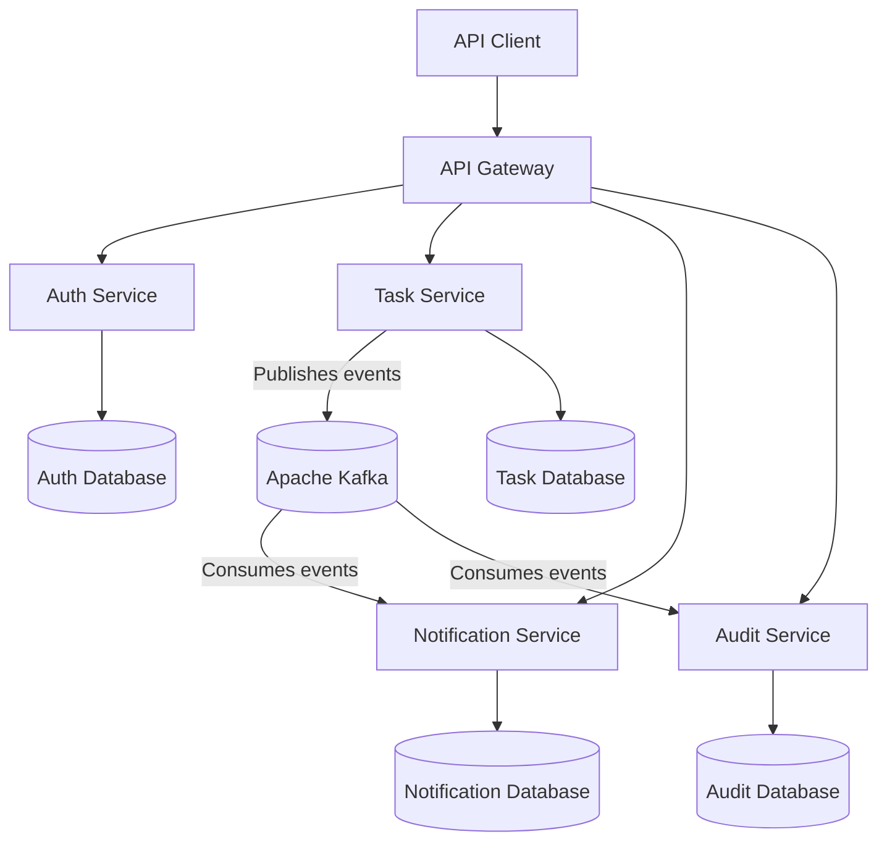

# DevFlow

**An event-driven task management backend built with Java, Spring Boot, Apache Kafka, and microservices.**


DevFlow is a backend engineering project designed to explore how independently deployed services communicate through REST APIs and asynchronous events. It combines task management, JWT-based authentication, notifications, and audit logging with containerization, automated testing, monitoring, and infrastructure as code.

The system was **deployed and functionally validated on AWS using a single-node K3s cluster**. The temporary cloud environment was subsequently destroyed with Terraform; this repository does not currently represent a publicly hosted service.

## Contents

- [Highlights](#highlights)
- [Architecture](#architecture)
- [Services](#services)
- [Technology stack](#technology-stack)
- [API overview](#api-overview)
- [Run locally](#run-locally)
- [Testing and CI/CD](#testing-and-cicd)
- [Observability](#observability)
- [Kubernetes and AWS](#kubernetes-and-aws)
- [AWS validation results](#aws-validation-results)
- [Repository structure](#repository-structure)

## Highlights

- **Event-driven architecture:** the Task Service publishes domain events to Kafka, consumed independently by Notification and Audit services.
- **Authentication:** registration, login, JWT issuance, and authenticated access through the API Gateway.
- **Task lifecycle:** create, list, retrieve, update, delete, and independently change task status or priority.
- **Persistence:** PostgreSQL databases separated by service responsibility, with schema migrations managed through Flyway.
- **Operational tooling:** Docker Compose, Kubernetes manifests, health probes, Prometheus, Grafana, and Kafka JMX metrics.
- **Delivery and infrastructure:** Maven-based tests, GitHub Actions workflows, versioned container images in GHCR, and Terraform for an optional AWS demonstration environment.

## Architecture



**Typical task-creation flow:**

1. A client registers or logs in through the API Gateway and receives a JWT.
2. The client sends an authenticated `POST /v1/tasks` request.
3. The Task Service persists the task in PostgreSQL and publishes a `task-created` event to Kafka.
4. Notification Service consumes the event and creates a notification.
5. Audit Service independently consumes the event and records the operation.

The services share a PostgreSQL server in the local/demo setup but use **separate logical databases**. Kafka decouples the task write path from the notification and audit consumers.

## Services

| Service | Port | Responsibility |
| --- | ---: | --- |
| API Gateway | `8080` | Single HTTP entry point; routing and JWT validation |
| Task Service | `8081` | Task CRUD, status and priority updates, Kafka event publishing |
| Notification Service | `8082` | Consumption of task events and creation of notifications |
| Audit Service | `8083` | Consumption and persistence of task audit events |
| Auth Service | `8084` | User registration, login, and JWT issuance |

### Kafka topics

The task lifecycle uses the following topics:

| Topic | Trigger |
| --- | --- |
| `task-created` | A task is created |
| `task-updated` | A task is updated |
| `task-deleted` | A task is deleted |
| `task-status-changed` | A task's status changes |
| `task-priority-changed` | A task's priority changes |

Notification and Audit services subscribe to these events in **separate consumer groups**, allowing each service to process events independently.

## Technology stack

| Area | Technologies |
| --- | --- |
| Backend | Java 25, Spring Boot 4.1.1, Spring Web MVC, Spring Cloud Gateway |
| Security | Spring Security, JWT |
| Messaging | Apache Kafka, Spring for Apache Kafka |
| Data | PostgreSQL 17, Spring Data JPA / Hibernate, Flyway |
| API and mapping | REST, Jakarta Bean Validation, MapStruct, OpenAPI / Swagger |
| Testing | JUnit, Spring Boot Test, Mockito, Testcontainers, REST Assured |
| Build and containers | Maven multi-module project, Docker, Docker Compose, GHCR |
| Orchestration | Kubernetes, K3s |
| Observability | Spring Boot Actuator, Micrometer, Prometheus, Grafana, JMX Exporter |
| Automation and cloud | GitHub Actions, Terraform, AWS EC2, IAM, VPC, Systems Manager, S3 remote state |

## API overview

All public-facing requests in the examples below go through `http://localhost:8080`.

### Authentication

| Method | Endpoint | Description |
| --- | --- | --- |
| `POST` | `/v1/auth/register` | Register an account |
| `POST` | `/v1/auth/login` | Authenticate and receive a JWT |

### Tasks

| Method | Endpoint | Description |
| --- | --- | --- |
| `POST` | `/v1/tasks` | Create a task |
| `GET` | `/v1/tasks` | List tasks |
| `GET` | `/v1/tasks/{id}` | Retrieve a task |
| `PUT` | `/v1/tasks/{id}` | Update a task |
| `PATCH` | `/v1/tasks/{id}/status?status=IN_PROGRESS` | Change task status |
| `PATCH` | `/v1/tasks/{id}/priority?priority=HIGH` | Change task priority |
| `DELETE` | `/v1/tasks/{id}` | Delete a task |

Available task statuses: `TODO`, `IN_PROGRESS`, `IN_REVIEW`, `DONE`, `CANCELLED`.

Available priorities: `LOW`, `MEDIUM`, `HIGH`, `ULTRA`.

### Example requests

Register an account:

```bash
curl -X POST http://localhost:8080/v1/auth/register \
  -H 'Content-Type: application/json' \
  -d '{
    "username": "devflow_user",
    "email": "devflow_user@example.com",
    "password": "change-this-password"
  }'
```

Log in:

```bash
curl -X POST http://localhost:8080/v1/auth/login \
  -H 'Content-Type: application/json' \
  -d '{
    "username": "devflow_user",
    "password": "change-this-password"
  }'
```

The login response contains a `token`. Use it as a bearer token when creating a task:

```bash
curl -X POST http://localhost:8080/v1/tasks \
  -H 'Content-Type: application/json' \
  -H 'Authorization: Bearer YOUR_JWT_TOKEN' \
  -d '{
    "title": "Validate DevFlow",
    "description": "Verify event-driven task processing",
    "status": "TODO",
    "priority": "HIGH"
  }'
```

These commands use POSIX-shell quoting (Bash, Git Bash, or WSL). In Windows PowerShell, use `curl.exe` and adapt the JSON quoting if necessary. Never commit or share real JWTs or passwords.

## Run locally

### Prerequisites

- **JDK 25** and **Maven** available on the command line.
- **Docker Engine / Docker Desktop** with the Compose plugin.
- `curl` (or an equivalent download tool) for the Kafka JMX Exporter agent.
- Sufficient memory to run PostgreSQL, Kafka, five JVM services, Prometheus, and Grafana.

### 1. Clone the repository

```bash
git clone https://github.com/MatheusHBn/DevFlow.git
cd DevFlow
```

### 2. Configure local environment variables

Create a `.env` file in the repository root:

```dotenv
DB_USERNAME=postgres
DB_PASSWORD=replace-with-a-local-password
JWT_SECRET=replace-with-a-long-random-secret-of-at-least-32-characters
JWT_EXPIRATION=3600000
GRAFANA_ADMIN_PASSWORD=replace-with-a-local-grafana-password
```

The `.env` file is intentionally excluded from Git. These are **example values only**; choose your own credentials before starting the stack.

### 3. Download the Kafka metrics agent

The Compose configuration mounts a JMX Exporter JAR that is intentionally not committed to the repository. Download the **1.7.0 Java agent** into the expected path:

```bash
curl -fL \
  https://github.com/prometheus/jmx_exporter/releases/download/1.7.0/jmx_prometheus_javaagent-1.7.0.jar \
  -o docker/kafka-exporter/jmx_prometheus_javaagent.jar
```

For supply-chain verification, the upstream release publishes SHA-256 checksums. The expected SHA-256 for this JAR is:

```text
0ad843261c567d1924a017d542e14c40f2afff523d940c25ee000742fde4b3a9
```

### 4. Create the external Kafka volume

```bash
docker volume create devflow_kafka_data
```

The volume is declared `external: true` in `docker-compose.yml`, so Compose will not create it automatically.

### 5. Build the application JARs

```bash
mvn clean package -DskipTests
```

**This step is required before building the Docker images.** The service Dockerfiles copy existing JAR files from each module's `target/` directory; they do not compile the Java sources inside Docker.

### 6. Start the stack

```bash
docker compose up -d --build
docker compose ps
```

Services may take a short time to initialize, especially on the first run.

| Component | Local address |
| --- | --- |
| API Gateway | `http://localhost:8080` |
| Task Service | `http://localhost:8081` |
| PostgreSQL | `localhost:5433` |
| Kafka | `localhost:9092` |
| Prometheus | `http://localhost:9090` |
| Grafana | `http://localhost:3000` |
| Kafka JMX metrics | `http://localhost:9404/metrics` |

Check the Gateway's health:

```bash
curl -i http://localhost:8080/actuator/health/readiness
```

A healthy response returns HTTP `200` and `{"status":"UP"}`.

### 7. Stop the stack

```bash
docker compose down
```

This preserves named volumes. **Do not use `docker compose down -v` unless you intentionally want to delete persistent local data.**

## Testing and CI/CD

The repository contains automated tests and GitHub Actions workflows covering build verification and release workflows.

Run the Maven test suite locally:

```bash
mvn clean verify
```

Some integration tests use **Testcontainers** and therefore require a running Docker engine. The root Maven build includes integration-test configuration for classes matching `*IT.java`.

The release workflow builds versioned service images and publishes them to **GitHub Container Registry (GHCR)**. Kubernetes-based smoke checks are also part of the release validation process.

- [GitHub Actions](https://github.com/MatheusHBn/DevFlow/actions)
- [Releases](https://github.com/MatheusHBn/DevFlow/releases)
- [Container packages](https://github.com/MatheusHBn?tab=packages)

## Observability

DevFlow exposes operational endpoints through **Spring Boot Actuator and Micrometer**. The local Docker Compose environment includes **Prometheus** and **Grafana**.

- **Application metrics:** `/actuator/prometheus` on each service.
- **Health checks:** `/actuator/health`, `/actuator/health/liveness`, and `/actuator/health/readiness`.
- **Kafka metrics:** JMX Exporter on port `9404`.
- **Dashboards:** Grafana at `http://localhost:3000`, using the credentials configured in `.env`.

The `k8s/monitoring/` directory contains additional Kubernetes monitoring configuration used during local cluster experimentation. Monitoring components were **not** deployed as part of the resource-constrained AWS demonstration.

## Kubernetes and AWS

The `k8s/` directory contains manifests for the five services, PostgreSQL, and Kafka, including Kubernetes **Deployments, StatefulSets, Services, resource requests/limits, and health probes**.

The Kubernetes deployment expects the `devflow` namespace and supporting objects, including:

- `postgres-credentials` — PostgreSQL credentials.
- `devflow-app-env` — service database URLs, Kafka addresses, JWT configuration, and inter-service URLs.
- `postgres-init` — ConfigMap generated from `docker/postgres/init.sql`.

Create these resources securely before applying the application manifests. Pin container images to the intended release tag; the image tags committed in individual manifests may not match the latest release.

The `terraform/` directory defines reusable AWS infrastructure and an **optional temporary EC2/K3s demonstration environment** in `terraform/environments/dev/`.

The AWS setup used:

- Amazon Linux 2023 on an `m7i-flex.large` EC2 instance.
- A single-node K3s cluster, accessed through AWS Systems Manager Session Manager rather than public SSH access.
- A temporary public subnet, routing, IAM instance profile, and security group provisioned with Terraform.
- A remote Terraform state backend in Amazon S3.

**This is a demonstration environment, not a production or highly available Kubernetes deployment.** Provisioning it requires your own AWS account, IAM permissions, and an initialized Terraform backend. AWS resources may incur charges.

After testing, the temporary resources can be removed **without destroying the base network** by applying:

```bash
terraform -chdir=terraform/environments/dev plan -var="enable_aws_demo=false"
terraform -chdir=terraform/environments/dev apply -var="enable_aws_demo=false"
```

Always review the Terraform plan before applying changes. Avoid running `terraform destroy` against the entire `dev` environment if you intend to preserve its base infrastructure.

## AWS validation results

**Validated on November 16, 2026**, using released service images deployed to a single-node K3s cluster in AWS (`sa-east-1`).

| Check | Observed result |
| --- | --- |
| Kubernetes control-plane node | `Ready` |
| Five Spring Boot services | `5/5` deployments available |
| PostgreSQL and Kafka | Both StatefulSets `1/1 Running`; persistent volumes bound |
| Container stability | All seven application Pods running without restarts during observation |
| Gateway health and readiness | HTTP `200`; readiness `UP` |
| User registration | HTTP `201` |
| User login | HTTP `200`; JWT issued |
| Authenticated task creation | HTTP `201` |
| Task retrieval by ID | HTTP `200`; returned persisted task |
| Notification consumer | Received `task-created` and created a notification |
| Audit consumer | Received and processed `TaskCreatedEvent` |
| Infrastructure cleanup | Terraform removed `10` temporary resources; base infrastructure preserved |

During one observation, the node reported approximately **4% CPU** and **48% memory** utilization. These are point-in-time measurements, **not performance benchmarks**.

This validation confirms the primary task-creation path across HTTP, authentication, persistence, Kafka publishing, and asynchronous consumers. It does **not** constitute an exhaustive load, resilience, security, or full CRUD regression test.

The demonstration EC2 instance and its temporary network resources were terminated after validation. **There is no live AWS endpoint associated with this repository.**

## Repository structure

```text
DevFlow/
├── .github/workflows/      # CI/CD automation
├── api-gateway/            # HTTP entry point and authentication checks
├── auth-service/           # User registration and login
├── task-service/           # Task management and Kafka publisher
├── notification-service/   # Kafka consumer and notification persistence
├── audit-service/          # Kafka consumer and audit persistence
├── docker/                 # PostgreSQL initialization and Kafka metrics config
├── k8s/                    # Application and monitoring manifests
├── terraform/              # AWS infrastructure as code
├── docker-compose.yml      # Local development stack
├── prometheus.yml          # Prometheus scrape configuration
└── pom.xml                 # Maven multi-module parent
```
